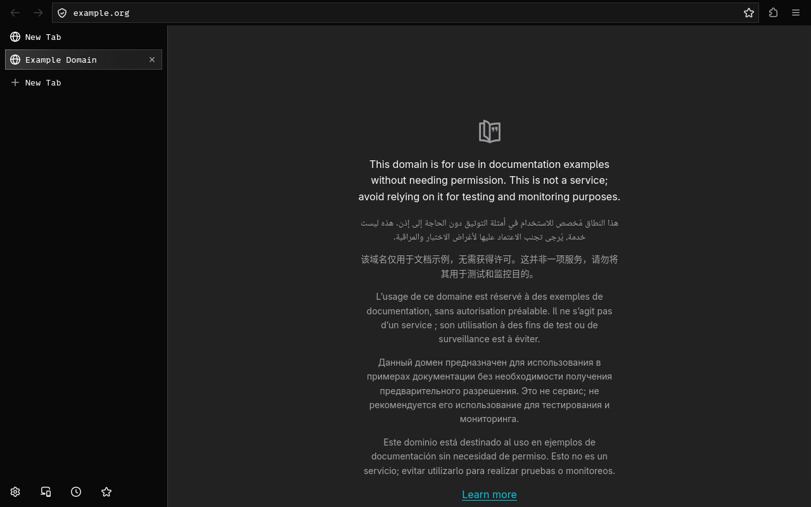
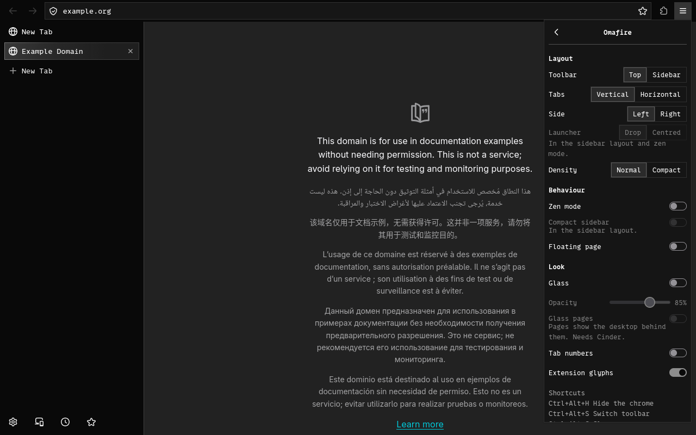

# Omafire

**The Firefox theme and toolkit for [Omarchy](https://omarchy.org/).**
Omafire themes Firefox from your current Omarchy theme and keeps it in step
live: a Nova userChrome theme with a Zen-style sidebar layout, a settings
panel and keybindings inside Firefox, and a setup that is safe with
profile-sync-daemon and never loses your own profile files.



| Sidebar layout | The settings panel |
|---|---|
|  |  |

Omafire grew out of [omafox](https://github.com/cover/omafox) (MIT) and
carried its name until 0.3.0.

## Features

- **Follows Omarchy.** Change your Omarchy theme and Firefox follows within a
  moment, tabs, toolbars, menus, sidebars, the new-tab page and Firefox's own
  pages, dark or light, including themes with partial palettes. The first
  painted frame of a restart already uses the current palette.
- **Layouts.** Toolbar on top or in a Zen-style sidebar, horizontal or
  vertical tabs, sidebar on either side, a drop or centred launcher, a compact
  sidebar that slides in on demand, zen mode, a floating page and split view.
- **Glass.** Optional translucent chrome over the desktop, blurred where your
  compositor blurs, with a readability floor measured against your wallpapers.
- **Settings everywhere.** One file, `~/.config/omafire/config.json`, driven
  from the CLI, an Omafire panel in Firefox's menu, keybindings and an icon in
  the Omarchy bar. All of them stay in step.
- **Safe.** Works with profile-sync-daemon, backs up your own files before
  touching them, writes atomically, and removes cleanly.
- **Local.** No account, network request, telemetry or background service.

## Requirements

- Omarchy 4 (Quattro) or newer.
- Firefox 156 or newer. Zen Browser is not supported.

What is tested, what is not, and the limits are in [docs/SUPPORT.md](docs/SUPPORT.md).

## Installation

Omafire is an Arch package, `omafire`. Forgejo CI builds each release from
its tag and attaches the package to the [release
page](https://git.hab.rip/habibe/omafire/releases).

1. Install the package from the latest release:

   ```bash
   sudo pacman -U omafire-<version>-1-x86_64.pkg.tar.zst
   ```

   It replaces the `omafox` and `omarchy-firefox` packages. An older,
   unpackaged Omarchy Firefox loader (`/usr/lib/firefox/mozilla.cfg` and
   friends) is removed if it is byte for byte a known version, and
   reported otherwise.

2. Enable it for your user, then restart Firefox:

   ```bash
   omafire setup
   ```

   Coming from omafox, the same command moves your profiles, settings,
   backups and theme hook to omafire's names. Until you run it, `omafox`
   still works: it forwards to `omafire`.

For Firefox that is all: the package carries the Mozilla-signed Omafire
extension, and the first browser window of each set-up profile installs it.
Do not also install upstream's `@omafox` from AMO in Firefox.

To build it yourself instead: `makepkg -si` with this repository's
`PKGBUILD` (it builds the Forgejo tag), or `make && sudo make install` for
the working tree.

Setup registers the Omarchy theme-change hook and immediately sends your
current palette to every connected browser. For each profile in
`~/.mozilla/firefox/profiles.ini` it installs the theme, small marked blocks
in `user.js`, `userChrome.css` and `userContent.css`, and the stylesheets that
keep the first paint on your palette. Restart Firefox once after setup. Run setup once for each
desktop user, and rerun it after creating a new browser profile. How each
file is written, and what is left alone, is in
[docs/SUPPORT.md](docs/SUPPORT.md#profile-safety).

## Usage

After setup, use Omarchy as usual. Changing the theme updates Firefox:

```bash
omarchy theme set catppuccin
```

Open the Omafire panel from Firefox's app menu (or Ctrl+Alt+O) to change the
layout and look, or click the Omafire button in either browser to see the
active theme, last sync and connection status. The command-line helper:

```bash
omafire status    # Show the current theme and integration state
omafire sync      # Queue the current palette for connected browsers
omafire payload   # Print the current normalized theme message
omafire setup     # Reconfigure the integration for this user
omafire remove    # Remove this user's hook and saved theme state
omafire get/set   # Read and change settings (see Settings)
omafire version   # Show the installed version
```

Keybindings: Ctrl+Alt+H hides the chrome (zen mode; compact in the sidebar
layout), Ctrl+Alt+S switches the toolbar, Ctrl+Alt+G toggles glass. They can
be rebound; see [docs/HOW-IT-WORKS.md](docs/HOW-IT-WORKS.md#firefox-chrome-scripts).

## Settings

Omafire's settings live in one file, `~/.config/omafire/config.json`, shared
by every Firefox profile omafire manages. It holds only what you changed;
everything else is its default. Change it with the CLI, by hand, or from
Firefox (the Omafire panel in the app menu, the keybindings, or
`about:config`): every running Firefox follows the file within a moment, and
a change made in Firefox is written back to it.

```bash
omafire get                  # every setting, key=value
omafire get opacity          # one value
omafire set glass on opacity 0.8
omafire reset opacity        # back to the default
omafire watch                # a JSON line now and after every change
```

| Setting | Values | Default |
|---|---|---|
| `toolbar` | `top`, `sidebar` | `top` |
| `tabs` | `horizontal`, `vertical` | `horizontal` |
| `side` | `left`, `right` (vertical tabs) | `left` |
| `launcher` | `drop`, `center` (sidebar layout and zen mode) | `drop` |
| `density` | `normal`, `compact` | `normal` |
| `zen-mode` | `true`, `false` (top toolbar) | `false` |
| `compact-sidebar` | `true`, `false` (sidebar layout) | `false` |
| `floating-page` | `true`, `false` | `false` |
| `glass` | `true`, `false` | `false` |
| `opacity` | `0.5` to `1` | `0.85` |
| `glass-pages` | `true`, `false` (with `glass` and Cinder) | `false` |
| `tab-numbers` | `true`, `false` | `false` |
| `tab-numbers-hold` | `true`, `false` (with `tab-numbers`) | `false` |
| `extension-glyphs` | `true`, `false` | `true` |
| `key-zen` | a shortcut such as `Ctrl+Alt+H`, or empty for none | `Ctrl+Alt+H` |
| `key-layout` | a shortcut, or empty | `Ctrl+Alt+S` |
| `key-glass` | a shortcut, or empty | `Ctrl+Alt+G` |
| `key-settings` | a shortcut, or empty | `Ctrl+Alt+O` |

The first Firefox to start without a file creates it from that profile's
settings. A value the file gets wrong is reported and its default used; a
file that is not JSON is left alone, and Firefox keeps its current settings
until it parses again. The extension's site-coloured tab is not in the file
yet.

### In the Omarchy bar

`omafire setup` adds an Omafire icon to the right of the Omarchy bar (a
plugin the package installs to `/usr/share/omafire/shell/omafire`, linked
into `~/.config/omarchy/plugins/omafire`). Its panel holds every setting
above and the state of each Firefox profile, with a Repair button
(`omafire setup`) when one needs it; the icon turns red until then.
Right-click toggles glass. Keyboard: j/k move, h/l change, Enter toggles,
r repairs.

Setup enables it once. Disable it with `omarchy plugin disable omafire` and
later setups leave it off; `omafire remove` takes it out.


## Troubleshooting

If a browser does not update after a theme change, run `omafire status`, then
`omafire setup` and `omafire sync`, and restart the browser. The full list of
messages, what each one means and what to do is in
[docs/SUPPORT.md](docs/SUPPORT.md#troubleshooting) and
[Recovery](docs/SUPPORT.md#recovery); to ask for help, see
[Getting help](docs/SUPPORT.md#getting-help).

## Uninstallation

Remove the per-user integration before uninstalling the package:

```bash
omafire remove
sudo pacman -Rns omafire
```

`omafire remove` also deletes the preferences that mark a Firefox profile as
Omafire's from `prefs.js` (`omafire.managed`, the forced page colours,
`omafire.extension.offered`, the accent colours): Firefox copies `user.js`
values there, and the loader keeps running while `omafire.managed` is set.
It only edits `prefs.js` while Firefox is closed, because a running Firefox
rewrites the file on exit; if Firefox is running it says so, and you run
`omafire remove` again after closing it. Feature toggles from the block
(Nova, Wayland, drag delay) stay.

Then remove the Omafire extension from Firefox's `about:addons` page.

A theme checkout used as `chrome/` keeps its own files: remove deletes only the
generated `omafire-*.css` beside them. If `remove` reports Firefox running, the
forced colours stay until you close it and run `omafire remove` again.

## Privacy

Omafire makes no network requests and does not collect or transmit data. It
reads your local Omarchy palette and wallpaper and writes the managed local
profile files described above. See the [privacy statement](PRIVACY.md).

## More

- [docs/SUPPORT.md](docs/SUPPORT.md): what is supported, troubleshooting,
  recovery, profile safety.
- [docs/HOW-IT-WORKS.md](docs/HOW-IT-WORKS.md): the parts, the chrome scripts,
  releases.
- [theme/README.md](theme/README.md): the theme's code and design language.

## Acknowledgements

Omafire was inspired by [omazed](https://github.com/APS6/omazed), which provides
live Omarchy theme switching for the Zed editor.

Omafire is released under the [MIT License](LICENSE).
